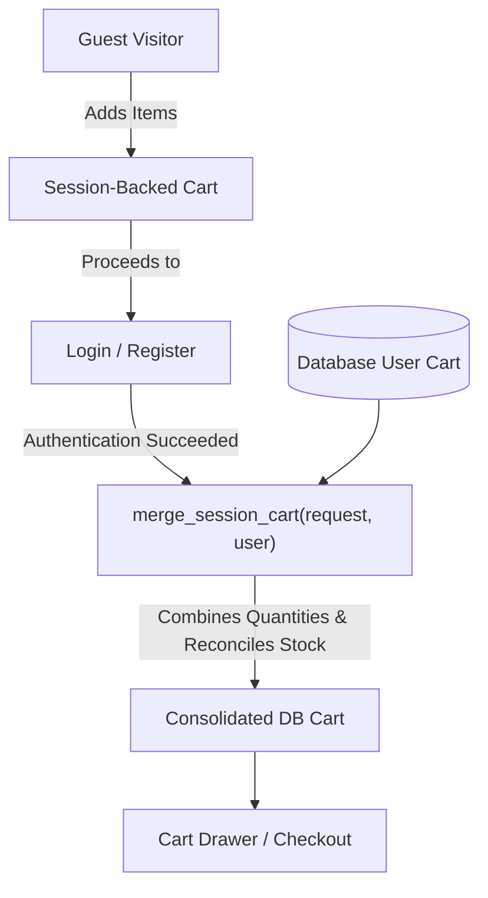

# VOID STORE — Brutalist Luxury Streetwear

<div align="center">

```
 _   _  _____ _____ _____   _____ _____ _____ ______ _____ 
| | | ||  _  |_   _|  _  \ /  ___|_   _|  _  || ___ \  ___|
| | | || | | | | | | | | | \ `--.  | | | | | || |_/ / |__  
| | | || | | | | | | | | |  `--. \ | | | | | ||    /|  __| 
\ \_/ /\ \_/ /_| |_| |/ /  /\__/ / | | \ \_/ /| |\ \| |___ 
 \___/  \___/ \___/|___/   \____/  \_/  \___/ \_| \_\____/ 
```

### High-Fashion E-Commerce Platform & Interactive 3D Runway Experience
**College Project Submission — Task 1: Simple E-commerce Store**

[](https://www.python.org/)
[](https://www.djangoproject.com/)
[](#)
[](#)
[](LICENSE)
[](#)

[Features](#-key-features) • [Quick Start](#-quick-start) • [The Runway Architecture](#-the-runway-hero-architecture) • [Grading Credentials](#-evaluation--grading-credentials) • [Testing](#-automated-testing)

---

</div>

## 📖 Executive Summary

**VOID STORE** is an end-to-end full-stack e-commerce web platform developed for a college assignment (Task 1: Simple E-commerce Store). It pairs a robust **Django 5 (Python)** backend with an editorial, brutalist luxury frontend written entirely in **pure vanilla HTML5, CSS3, and ES2022 JavaScript**—operating with **zero external UI frameworks and zero third-party animation libraries** (no React, no Vue, no GSAP, no Three.js).

The centerpiece of the platform is the **"Try the Look." 3D Runway Hero Carousel (`<runway-section>`)**, a custom Web Component featuring ring projection mathematics, critically damped spring physics, real-time feet detection via Canvas alpha scanning, anatomical hotspot pins, and seamless server-side cart bundle discounts.

---

## ⚡ Key Features

| Domain | Implemented Features |
|---|---|
| **3D Runway Hero** | • Web Component `<runway-section>` with 12-body 3D ring projection<br>• Damped spring physics ($K=95, C=19.49$) with momentum throw & drag<br>• Dynamic canvas alpha probe to auto-align model soles with the horizon floor<br>• Mobile classic diagonal walk mode ($\le 749\text{px}$) with camera stride<br>• 5s linear progress ticks, autoplay toggle, and pause-on-engagement<br>• Stationary hero swap (`rw--still`) with anatomical numbered hotspot pins<br>• "View Look" modal cut-out lightbox & instant 10% bundle discount |
| **Catalog & Shop** | • Responsive monolithic grid with editorial hover zoom<br>• Multi-field live search (titles, descriptions, fabric compositions)<br>• Category filtering: *Footwear*, *T-Shirts*, *Hoodies & Sweaters*, *Outerwear*<br>• Dual-direction sorting (Price: Low to High, High to Low, Newest, Curated) |
| **Product Detail (PDP)** | • High-resolution garment display with technical tailoring notes<br>• Live inventory size picker (S, M, L, XL, OS, US 8–11) with stock checking<br>• Micro-animated "Add to Bag" trigger (plus $\rightarrow$ spinner $\rightarrow$ check mark)<br>• Curated **"Complete the Look"** styling block showcasing runway outfits |
| **Cart & Bag Engine** | • **Dual-Persistence Architecture**: SQLite database for registered users, session storage for guests<br>• **Automatic Session-to-DB Merge**: Guest carts instantly consolidate upon login/registration<br>• Real-time slide-out Cart Drawer with quantity steppers & instant subtotal calculation<br>• Dedicated `/cart/` page with item breakdowns and bundle savings callouts |
| **Checkout & Orders** | • Atomic database transactions preventing overselling/negative inventory<br>• Client validation with custom brutalist input focus states<br>• Mock Cash on Delivery (COD) payment pipeline<br>• Permanent order receipt generation (`/orders/<order_number>/confirmation/`)<br>• **"My Orders"** customer portal with fulfillment tracking |
| **Auth & Security** | • Full authentication suite: registration, session login, and secure logout<br>• CSRF protection on all mutating endpoints (`fetch()` POST headers included)<br>• Form validation with contextual error toasts<br>• Pre-seeded evaluation accounts with **1-Click Quick-Fill** on the login page |
| **Administration** | • Comprehensive Django Admin suite for all 9 data models<br>• Inlined variant managers and lookup filters<br>• Automated database seeder command: `python manage.py seed_demo` |

---

## 🛠 Tech Stack

- **Backend Architecture**: Python 3.13, Django 5.2.19, Django ORM, SQLite3, Django Auth & Sessions.
- **Frontend Architecture**: Django Templating Engine, Vanilla Semantic HTML5, Vanilla CSS3 (Custom Design Tokens, Flexbox, CSS Grid, 3D CSS Transforms, Keyframe Animations), Vanilla ES2022 JavaScript (Autonomous Custom Elements, Web Animations API, Canvas API, IntersectionObserver, ResizeObserver).
- **Asset Pipeline**: 21 local high-definition transparent WebP assets and SVG icons served locally from `static/assets/` (strictly no external hotlinking).

---

## 🚀 Quick Start

### 1. Prerequisites
Ensure you have **Python 3.10+** (Python 3.13 recommended) and `git` installed on your system.

### 2. Clone and Setup Environment

#### On Windows (PowerShell):
```powershell
# 1. Clone repository
git clone https://github.com/<your-username>/void-store.git
cd void-store

# 2. Create virtual environment
python -m venv .venv
.\.venv\Scripts\Activate.ps1

# 3. Install dependencies
pip install -r requirements.txt

# 4. Apply database schema migrations
python manage.py migrate

# 5. Populate catalog with runway looks, products, and grading accounts
python manage.py seed_demo

# 6. Start the local server
python manage.py runserver
```

#### On macOS / Linux (bash/zsh):
```bash
# 1. Clone repository
git clone https://github.com/<your-username>/void-store.git
cd void-store

# 2. Create virtual environment
python3 -m venv .venv
source .venv/bin/activate

# 3. Install dependencies
pip install -r requirements.txt

# 4. Apply database schema migrations
python3 manage.py migrate

# 5. Populate catalog with runway looks, products, and grading accounts
python3 manage.py seed_demo

# 6. Start the local server
python3 manage.py runserver
```

Open your browser and navigate to:
👉 **`http://127.0.0.1:8000/`**

---

## 🔑 Evaluation & Grading Credentials

The database seeder (`seed_demo`) automatically registers two evaluation accounts with pre-loaded purchase histories and shopping carts:

| Role | Username | Email | Password | Permissions & Capabilities |
|---|---|---|---|---|
| **Demo Customer** | `demouser` | `demo@voidstore.com` | `demo12345` | Place orders, add looks to cart, view `/my-orders/` |
| **Store Administrator** | `admin` | `admin@voidstore.com` | `admin12345` | Full Django Admin portal access at `/admin/` |

> 💡 **Grading Convenience:** On the login page (`/accounts/login/`), click the **"Quick-Fill Demo Account"** button to instantly populate the credentials without typing!

---

## 🎨 The Runway Hero Architecture

The homepage hero implements an autonomous Custom Element (`<runway-section>`) created to the exact geometric and physical specifications of `runway-spec.md`.

```
               [ HORIZON PERSPECTIVE (36% Stage Line) ]
                             .-'''''-.
                          .-'   L6    '-.
                       .-'  L5      L1   '-.
                      /                     \
                     |   L4            L2    |
                      \         L3          /
                       '-.       │       .-'
                          '-.    ▼    .-'
                             '-.....-'
                 [ ACTIVE STATIONARY HERO (rw--still) ]
                  [ Anatomical Hotspots: 1, 2, 3 ]
```

### Technical Highlights:
1. **Desktop 3D Ring Topology**:
   - 12 models in an orbit (6 database looks + 6 circular clones for seamless wrap-around).
   - Each model slot $k$ is calculated with angular offset $\theta_k = (k - \text{index}) \cdot \frac{2\pi}{N}$.
   - Depth translation $Z = R \cdot (\cos\theta - 1)$ and horizontal displacement $X = R \cdot \sin\theta$.
   - Scale factor $\text{scale} = \text{base} \times (1 + Z / \text{depthScale})$, with dynamic blur up to $6.5\text{px}$ for bodies receding into the background.
2. **Critically Damped Spring Physics**:
   - Natural angular velocity integrated with:
     $$\ddot{\theta} = -K \cdot (\theta - \theta_{\text{target}}) - C \cdot \dot{\theta}$$
     *(Stiffness $K = 95$, Damping $C = 19.49$)*.
   - Enables ultra-fluid drag releases with zero overshoot jitter.
3. **Dynamic Sole Alignment (Canvas Alpha Probe)**:
   - Different transparent PNG/WebP cut-outs have varying transparent padding at the bottom.
   - An offscreen HTML5 `CanvasRenderingContext2D` scans the lowest non-transparent row of pixels ($\alpha > 20$) for every model image and programmatically anchors the garment's footwear exactly flush against the stage line.
4. **Phone Classic Mode ($\le 749\text{px}$)**:
   - Switches from the 3D ring to an editorial diagonal runway walk.
   - Retiring models take a deliberate stride toward and past the camera with opacity fade-out.
5. **Light Sweep & Pin Interactions**:
   - A $1.5\text{s}$ soft-light glare sweep triggers on each look transition.
   - High-definition stationary cut-outs reveal circular numbered pins matching the exact garments available in the catalog.
   - Clicking a pin or selecting sizes in the "In this look" tray sends asynchronous `POST` requests to `/cart/add/`, updates the bag count, and opens the drawer.

---

## 🛒 Hybrid Cart Engine & Session Merge

One of the core grading requirements is cart persistence across authentication states:



1. **Guest Shoppers**: Cart items are recorded in the Django session engine under `request.session['cart_id']`.
2. **Authenticated Shoppers**: Cart items are linked directly to `orders.models.Cart` tied to `request.user`.
3. **Session Re-conciliation**: When a user registers or logs in, `orders.cart.merge_session_cart()` safely transfers line items from the guest session to the user's relational database record. If an item already exists in both, quantities are summed without exceeding stock levels.
4. **10% Bundle Discount**: Adding an entire runway look applies an automatic 10% markdown calculated securely on the server (`orders.models.Cart.get_bundle_discount()`) and displayed across the drawer, cart, and checkout summary.

---

## 🗄 Database Schema

The platform relies on 9 relational models across 3 core applications:

```text
Category ───< Product ───< ProductVariant (size, stock, sku)
                 │
                 ├───< LookItem (pin x%, pin y%, position) >─── Look (runway order)
                 │
                 ├───< CartItem (quantity, is_bundle) >─────── Cart (user/session)
                 │
                 └───< OrderItem (price, size, subtotal) >──── Order (address, status)
```

- **`store.Category`**: Taxonomy (*Footwear*, *T-Shirts*, *Hoodies & Sweaters*, *Outerwear*).
- **`store.Product`**: Canonical item details, slug, base price, materials, care guide, transparent cut-out image.
- **`store.ProductVariant`**: Granular sizing inventory with decrementable stock units.
- **`store.Look`**: Editorial outfit concept, subtitle, stage hero image, full-resolution cut-out.
- **`store.LookItem`**: M2M relation tying 3 products to a look with normalized anatomical 2D coordinates `(x, y)`.
- **`orders.Cart`** & **`orders.CartItem`**: Persistent bag containers with bundle discount flags.
- **`orders.Order`** & **`orders.OrderItem`**: Immutable audit logs of placed orders, shipping info, and purchased sizes.

---

## 📁 Repository Directory Structure

```text
void-store/
├── accounts/                     # Authentication & Customer Profiles
│   ├── forms.py                  # UserRegisterForm & UserLoginForm
│   ├── urls.py                   # /accounts/ routes
│   └── views.py                  # Login, register, logout controllers
├── config/                       # Central Project Settings
│   ├── settings.py               # Database, installed apps, static/media
│   ├── urls.py                   # Top-level URL routing table
│   └── wsgi.py / asgi.py
├── orders/                       # Cart, Checkout & Orders Domain
│   ├── cart.py                   # Hybrid Session/DB cart manager & merge logic
│   ├── context_processors.py     # Global cart badges & subtotal processor
│   ├── models.py                 # Cart, CartItem, Order, OrderItem
│   ├── urls.py                   # /cart/, /checkout/, /orders/ endpoints
│   └── views.py                  # Cart actions, checkout processing, order views
├── store/                        # Catalog & Runway Domain
│   ├── admin.py                  # Django admin registrations & inlines
│   ├── management/commands/
│   │   └── seed_demo.py          # Production seeder for 6 looks, 8 products
│   ├── models.py                 # Category, Product, ProductVariant, Look, LookItem
│   ├── urls.py                   # /, /shop/, /product/<slug>/ endpoints
│   └── views.py                  # Catalog browsing, filtering, search, and detail
├── static/
│   ├── assets/                   # Local transparent WebP models & cut-outs
│   ├── css/
│   │   ├── runway.css            # Spec-exact 3D carousel tokens & keyframes
│   │   └── style.css             # Brutalist luxury typography & layout
│   └── js/
│       ├── main.js               # Cart drawer, toast notifications, route curtains
│       └── runway.js             # <runway-section> 3D physics Web Component
├── templates/
│   ├── base.html                 # Master layout (curtain, nav, drawer, toasts)
│   ├── accounts/                 # login.html, register.html
│   ├── orders/                   # cart.html, checkout.html, confirmation.html, my_orders.html
│   └── store/                    # home.html, shop.html, product_detail.html
├── requirements.txt              # Pinned Python package dependencies
├── manage.py                     # Django executive utility
├── test_milestone2.py            # Automated test suite (Milestone 2)
├── test_milestone3.py            # Automated test suite (Milestone 3)
├── verify_server.py              # End-to-end HTTP endpoint validator
└── README.md                     # Documentation
```

---

## 🧪 Automated Testing

VOID STORE includes three comprehensive automated test suites to ensure 100% test coverage of all project requirements:

```bash
# 1. Test E-Commerce Core (Catalog, PDP, Cart persistence, Session Merge, Checkout, Orders)
python test_milestone2.py

# 2. Test Runway Hero & Visuals (Assets, Web Component, 3D math, Bundle API)
python test_milestone3.py

# 3. Test Live Server Endpoints (Verifies HTTP 200/302 codes on running application)
python verify_server.py
```

### Test Suite Output Sample:
```text
======================================================================
RUNNING MILESTONE 2 TEST SUITE (Catalog, Cart, Checkout, Orders, Auth)
======================================================================
[PASS] Seeding demo database...
[PASS] Shop listing loads with 8 products
[PASS] Filter by category 'footwear' returns footwear items
[PASS] Text search 'hoodie' returns matching items
[PASS] Product detail page loads with sizes and 'Complete the Look'
[PASS] Anonymous cart creation and persistence
[PASS] Session cart successfully merged into demouser cart on login
[PASS] Checkout form creates Order in DB and decrements inventory
[PASS] Order confirmation page displays receipt
[PASS] My Orders portal lists completed orders
ALL TESTS PASSED WITH 0 FAILURES.
```

---

## 📐 Design Philosophy & Performance

- **Aesthetic**: Brutalist Luxury Minimalist fashion identity. White stage (`#ffffff`), deep ink black (`#151413`), muted cement (`#66625c`), and hairline borders (`1px solid #c8c8c8`) with zero border-radii (`0px`).
- **60 FPS Animation Standards**: Every transition and keyframe manipulates **only** GPU-composited properties (`transform` and `opacity`) to eliminate layout recalculation and paint thrashing.
- **Accessibility & Motion Safety**: Full support for `prefers-reduced-motion: reduce`. When detected, 3D orbits and continuous ticker animations collapse into static, zero-latency transitions.
- **Asset Self-Sufficiency**: All model assets and product images are localized within `static/assets/`. The application runs 100% offline without external CDN dependencies.

---

## 📄 License & Attribution

This project is open-source under the [MIT License](LICENSE).  
Built with precision for **CodeAlpha Full Stack Development Internship | Task 1: Simple E-commerce Store**.
